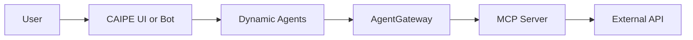

# MCP Servers

CAIPE uses MCP servers as tool backends for Dynamic Agents.

## Packaged Integrations

The Helm chart can deploy MCP servers with `mcp-*` aliases:

| Alias | Purpose |
|---|---|
| `mcp-argocd` | ArgoCD and GitOps operations |
| `mcp-backstage` | Backstage catalog access |
| `mcp-confluence` | Confluence content access |
| `mcp-github` | GitHub repository operations |
| `mcp-gitlab` | GitLab repository operations |
| `mcp-jira` | Jira issue operations |
| `mcp-komodor` | Kubernetes troubleshooting |
| `mcp-pagerduty` | PagerDuty incident data |
| `mcp-slack` | Slack workspace operations |
| `mcp-splunk` | Splunk search and observability |
| `mcp-victorops` | VictorOps incident data |
| `mcp-webex` | Webex workspace operations |
| `mcp-netutils` | Network utility tools |

## Infrastructure Control Agents

These agents give CAIPE real control (not just read-only reporting) over a
live infra stack: CI, Kubernetes, observability, and Azure. Each is opt-in via
its own Compose/Helm profile — none are part of the default minimal bundle.

| Agent | Scope | Write actions |
|---|---|---|
| `jenkins-ci-ops` | Jenkins-on-AKS build/queue, ACR, Key Vault, Terraform state visibility | Tier-3 actions (`terraform_apply`, `keyvault_set_secret`) are deliberately stubbed — infra-apply and secret-write risk require a separate reviewed approval gate |
| `kubernetes-ops` | Pod/Deployment/StatefulSet status, logs, events beyond what ArgoCD's own Application API covers | `confirm=True`-gated: rollout restart, scale, delete pod |
| `observability-ops` | SigNoz query-service + the dedicated `signoz` ClickHouse database: service health, trace/log/metric queries | `confirm=True`-gated: restart an unhealthy observability component (delegates to `kubernetes-ops`) |
| `azure-power-ops` | Power on/off and status for Azure compute (AKS clusters, VMs) by customer environment | Live: `az aks start/stop` |
| `azure-cost-ops` | Cost/spend analysis and budget reporting across Azure subscriptions | Read-only |
| `azure-cluster-ops` | AKS cluster lifecycle: scale, upgrade, node pool status | Live, by customer environment |
| `azure-core-services-ops` | Shared Azure platform services: Key Vault, networking, storage | Live status/control |

Credentials for the Azure-scoped agents use a dedicated service-principal
pattern (`ARM_CLIENT_ID/SECRET/TENANT_ID/SUBSCRIPTION_ID`), resolved either
from a plain env var or, when `CAIPE_CREDENTIALS_ENABLED=true`, via CAIPE's
OpenBao-backed credential-exchange API — never dropped into `.env` directly.
`kubernetes-ops` and `jenkins-ci-ops` never take a raw shell/SQL passthrough:
every action is a fixed, named tool, not an arbitrary command.

## Runtime Flow

Dynamic Agents select and call MCP tools directly or through AgentGateway. Use
the UI admin settings or Helm values to configure which MCP servers are
available to each agent.

## Add Another MCP Server

Use the [Creating an MCP Server](../development/creating-mcp-server.md) guide
for new integrations.
