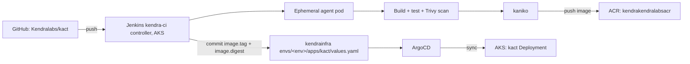

# kact CI/CD: GitHub → Jenkins → ACR → kendrainfra → ArgoCD

Cross-repo reference for the `kact` service's Azure CI/CD pipeline (E16,
designed 2026-11-18 to 2026-11-21 in the `Kendralabs/kact` repo). The code
lives in `kact` and `infra` (`kendrainfra`); this page exists because the
flow spans three repos and is otherwise invisible from any one of them.
Source of record for design rationale: `kact`'s ADR-0003 and
`finops/2026-11-18-azure-cicd-impact.md`.

**Status (2026-11-25): designed, partially wired, never run end to end.**

## Flow

## Hard boundary

**Jenkins holds no AKS role and never runs `helm`/`kubectl`.** Its only
write into the cluster's desired state is a Git commit to `kendrainfra`;
ArgoCD does every actual deployment. This mirrors the "no raw passthrough,
every capability its own typed surface" principle used elsewhere in this
repo (see `jenkins-ci-ops`'s tool design in
[Infrastructure Control Agents](../../agents/README.md)) — applied here at
the pipeline level rather than the MCP-tool level.

## GitHub Apps

Two separate GitHub Apps, deliberately not one:

| App | Scope | Used for | Install status |
|---|---|---|---|
| (existing `kact` CI app) | — | kact's own Jenkinsfile build/test (credential id `kact-gitops-app`) | installed, in use (PR #58, #59 merged) |
| `kact-gitops` (App ID `5824233`) | Contents: write, Metadata: read | The `kendrainfra` commit step only — narrowest scope that can write `values.yaml` | **not yet installed on `Kendralabs/kendrainfra`** |

`kact-gitops`'s private key and app ID live in Key Vault
`kendra-kendralabs-kv` (names only — no values here). Written from an
in-cluster pod via workload identity `kendra-workload`, because the vault
is private-network-only; this is the same in-cluster-pod write pattern
used for `jenkins-slack-token` and the Azure agents' credentials — see
`docker-compose-first-install`'s sibling runbooks and
[`azure-power-ops-provisioning-runbook.md`](../2026-05-20-openbao-credential-exchange/azure-power-ops-provisioning-runbook.md)
for the general pattern, not this specific secret.

## Open items (as of 2026-11-25, per the kact project)

- `kact-gitops` App not yet installed on `Kendralabs/kendrainfra`.
- `kendrainfra` PR #11 (open): moves the three kact ArgoCD `Application`s to
  `apps/services/azure/core-kact-api-{dev,staging,prod}.yaml`, project
  `core`, **MANUAL** sync until cluster secrets and env values exist; widens
  `AppProject core` destinations accordingly. `helm lint charts/kact-api`
  passes.
- Change request to `kendra-ci` (posted `#dev-ci-cd`, 2026-11-18, no reply
  yet): a `deployToEnvGitOps` shared-library step, the `kact-gitops-app`
  credential, a multibranch job for `Kendralabs/kact`, a
  `kact-prod-approvers` group.
- Env URLs/hosts, cluster secrets/ConfigMap, and prod-approver identity not
  yet defined.
- ACR image retention deferred — Basic SKU has none.
- Full pipeline, including a forced dev-stage failure that must not
  promote to staging/prod, not yet exercised end to end.

## Where this touches caipe

- `jenkins-ci-ops` (this repo's MCP agent for Jenkins/ACR/Key Vault
  visibility, see [Infrastructure Control Agents](../../agents/README.md))
  is the read/plan surface an operator or chat agent would use to check
  this pipeline's build status or queue — it is generic to any job on the
  `kendra-ci` controller, kact included.
- Its source currently lives only on branch `prebuild/feat/infra-ops-mcp-local`
  (not yet merged to `main`); `main`'s `ai_platform_engineering/mcp/jenkins_ci_ops/`
  directory has no tracked source despite `config.yaml` already listing
  `jenkins-ci-ops` as a registered `mcp_servers` entry. Merging that branch
  is a separate decision, not covered here.
